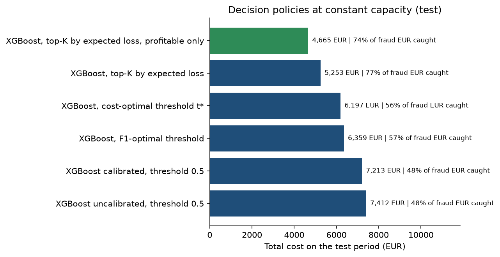
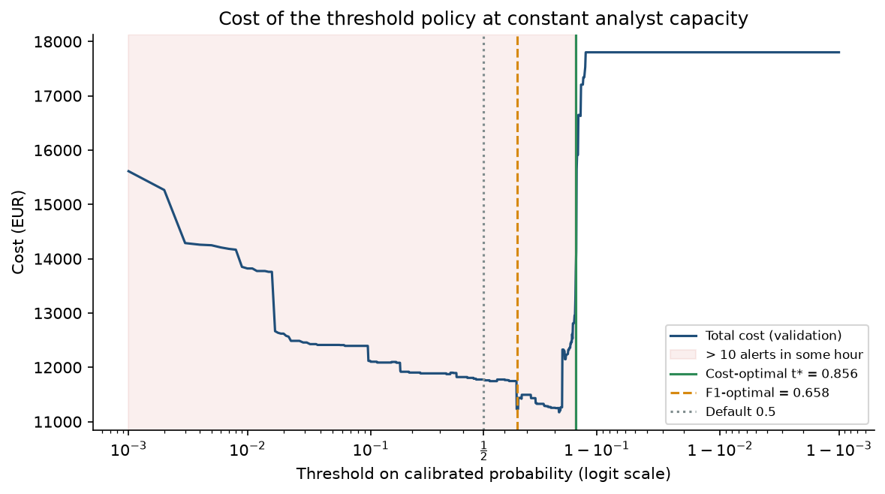
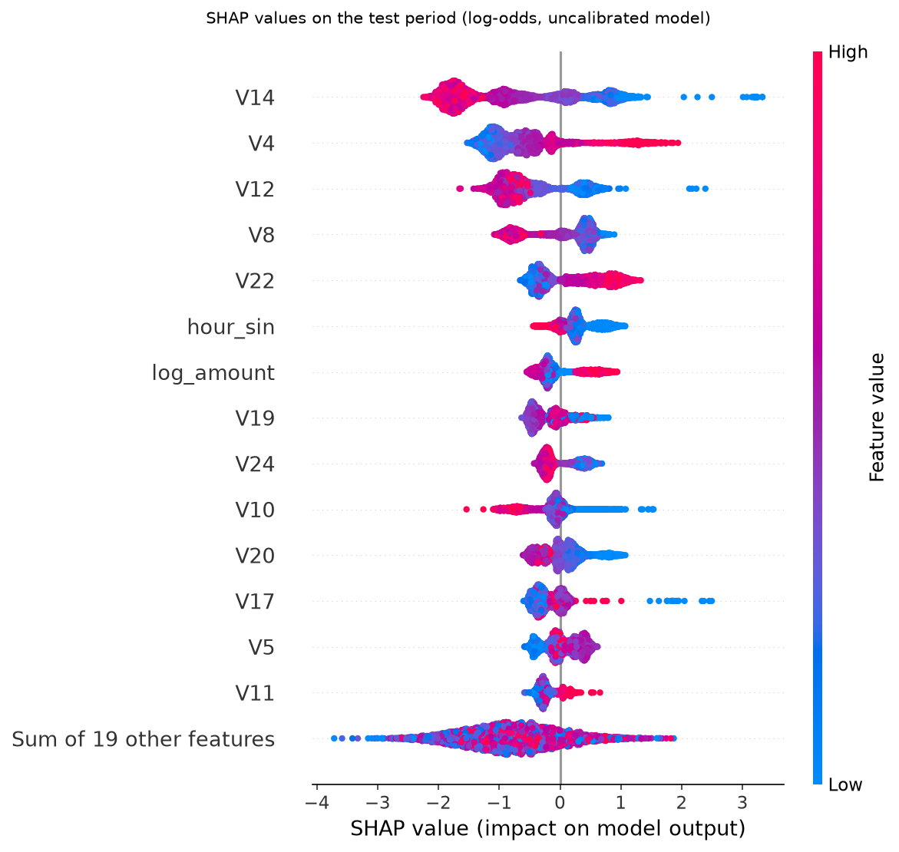
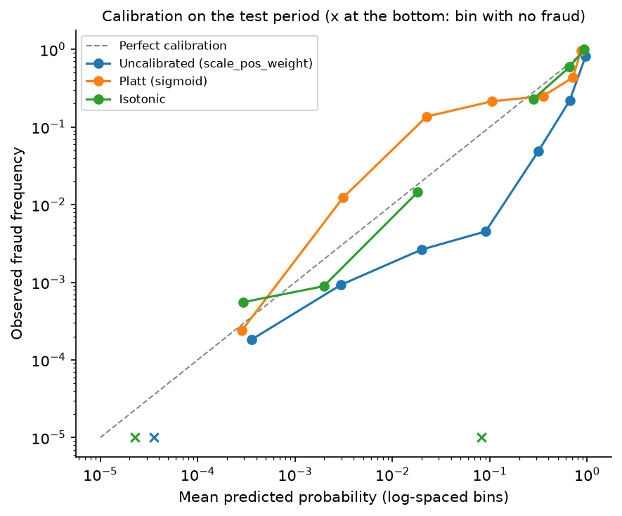
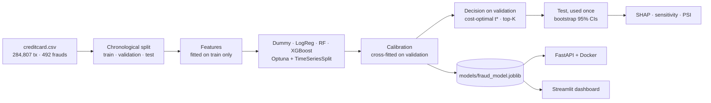

# Fraud detection: from data to decision, in production

A bank cannot investigate every suspicious transaction. Analysts have a limited capacity,
every alert costs time, and every legitimate customer blocked by mistake may leave.
This project does not stop at maximising a score: it **chooses the alerts that minimise the
total cost** (missed fraud + investigations + customer friction) **under the analysts'
capacity constraint**. Probabilities are calibrated, every alert is explained with SHAP,
and the model is served by a FastAPI API in Docker, tested in CI and tracked with MLflow.

## Results

All numbers below are generated by `make train` from [reports/results.json](reports/results.json):
none is typed by hand.

<!-- RESULTS:START -->

Test period: last 25% of the timeline (71,202 transactions, 94 frauds, 10,839 EUR of fraud). All policies at a constant capacity of **K = 10 alerts/hour**; costs c_inv = 5 EUR, c_fp = 10 EUR, recovery r = 0.8.

| Model / policy | PR-AUC test [95% CI] | Recall | Precision | Alerts | False positives | Total cost (EUR) |
|---|---|---|---|---|---|---|
| Dummy (prior), threshold 0.5 | 0.001 [0.001, 0.002] | 0.0% | 0.0% | — | — | 10,839 |
| Logistic regression, threshold 0.5 | 0.684 [0.581, 0.786] | 2.1% | 2.0% | — | — | 12,256 |
| Random forest, threshold 0.5 | 0.807 [0.728, 0.878] | 62.8% | 93.7% | — | — | 6,223 |
| XGBoost uncalibrated, threshold 0.5 | 0.777 [0.692, 0.850] | 51.1% | 58.5% | 82 | 34 | 7,412 |
| XGBoost calibrated, threshold 0.5 | 0.777 [0.692, 0.850] | 59.6% | 78.9% | 71 | 15 | 7,213 |
| XGBoost, F1-optimal threshold | 0.777 [0.692, 0.850] | 59.6% | 83.6% | 67 | 11 | 6,359 |
| XGBoost, cost-optimal threshold t* | 0.777 [0.692, 0.850] | 48.9% | 100.0% | 46 | 0 | 6,197 |
| XGBoost, top-K by expected loss | 0.777 [0.692, 0.850] | 39.4% | 37.0% | 100 | 63 | 5,253 |
| **XGBoost, top-K by expected loss, profitable only** | 0.777 [0.692, 0.850] | 28.7% | 77.1% | 35 | 8 | **4,665** |
| *Reference: no alert at all* | — | 0% | — | 0 | 0 | 10,839 |

Key numbers (cost reductions with a paired bootstrap over test transactions):

- **Top-K by expected loss** (profitable investigations only) vs the default `predict()` threshold 0.5: **37.1%** cost reduction (95% CI [12.4%, 59.1%], significant); vs the cost-optimal threshold: 24.7% (95% CI [4.3%, 48.4%], significant).
- **Cost-optimal threshold t\* = 0.856** (chosen on validation) vs 0.5: 16.4% (95% CI [-11.6%, 42.8%], **not significant**).
- Why top-K wins: ranking by p × amount, it stops 74% of the fraud amount with 27 frauds caught, vs 56% with 46 for the threshold, which ignores the amount.
- With K = 10, t\* is set by capacity, not by costs: it is the loosest threshold that never exceeds K alerts in any validation hour (the cheapest threshold, 0.812, would put 31 alerts in one hour). It is the same for all 16 cost hypotheses of the sensitivity analysis.
- XGBoost vs random forest, PR-AUC validation 0.807 vs 0.774, test 0.777 vs 0.807: the intervals overlap, XGBoost is not significantly better here.
- Calibration: **sigmoid** selected (out-of-fold Brier on validation, log-loss tie-break). Test Brier 0.000714 → 0.000500.
- Top-3 SHAP features: V14, V4, V12.
- Score PSI train → test: 0.179 (watch).

Full French interview sheet: [reports/fiche_resultats.md](reports/fiche_resultats.md). Raw numbers: [reports/results.json](reports/results.json).

<!-- RESULTS:END -->

| | |
|---|---|
|  |  |
|  |  |

More figures in [reports/figures](reports/figures): precision-recall curves, sensitivity
analysis, SHAP waterfalls (true positive, false positive, missed fraud), PSI drift, EDA.

## Pipeline



One scikit-learn object (features → XGBoost → calibrator) is used for training, the API
and the dashboard: no train/serve skew.

## Quickstart

Python 3.11. On Windows without `make`, `.\tasks.ps1 <target>` runs the same targets.

```bash
make install      # pip install -r requirements-dev.txt
make data         # downloads data/raw/creditcard.csv (~150 MB)
make train        # full pipeline (~6 min on a laptop): model, figures, results, README, MLflow
make test         # unit tests (no dataset needed)
make api          # http://localhost:8000/docs
make dashboard    # http://localhost:8501
make mlflow       # http://localhost:5000
```

`make train-fast` reuses the tuned hyper-parameters (`models/best_params.json`) and skips
Optuna. `make smoke` runs the whole pipeline on synthetic data in ~30 s (used in CI).

## Project structure

```
configs/config.yaml        every hypothesis (costs, capacity, split, tuning) in one place
src/
  data.py                  download, validation, chronological split
  features.py              FraudFeatureEngineer (sklearn transformer)
  models.py                Dummy, logistic regression, random forest, XGBoost pipelines
  tune.py                  Optuna (TPE) + TimeSeriesSplit, objective PR-AUC
  calibration.py           FrozenEstimator + CalibratedClassifierCV, cross-fitting
  cost.py                  cost model, capacity, threshold and top-K policies
  metrics.py               PR-AUC, precision@K, bootstrap confidence intervals
  explain.py               SHAP (TreeSHAP) and reason codes
  monitoring.py            Population Stability Index
  train.py                 end-to-end orchestration
  report.py                README results + French interview sheet from results.json
  predict.py               production bundle + FraudScorer (API and dashboard)
  api/main.py, schemas.py  FastAPI service
app/dashboard.py           Streamlit decision dashboard
tests/                     pytest: cost function, features, metrics, split, PSI, SHAP, API
models/                    fraud_model.joblib, best_params.json
reports/                   results.json, fiche_resultats.md, figures/
```

## Method

**Data.** [Credit Card Fraud Detection](https://www.kaggle.com/datasets/mlg-ulb/creditcardfraud)
(ULB Machine Learning Group / Worldline): 284,807 European card transactions over 2 days
(September 2013), 492 frauds (0.172%). `V1..V28` are PCA components (anonymised),
`Time` is in seconds since the first transaction, `Amount` in EUR. Predicting "never fraud"
gives 99.83% accuracy, so accuracy is useless here.

**Chronological split.** Rows are sorted by `Time` and cut without shuffling: in production
we predict the future from the past. Validation and test each need about 80+ frauds.
The fraud rate drops on day 2 (0.21% in the first 60% of the timeline, 0.10% in the next
20%), so 60/20/20 leaves only 57 frauds in validation and 75 in test. The pipeline therefore falls
back to **50/25/25** (129 and 94 frauds). Note that 70/15/15 would make it worse (56 and 52).

**Features** (fitted on the training data only, inside the pipeline):
`log_amount`, cyclic hour `hour_sin`/`hour_cos`, `is_night`, `amount_zscore_hour` (amount
unusual for the hour, mean/std learned on train), and `V1..V28`. Raw `Time` is dropped.

**Models and imbalance.** Dummy (floor), logistic regression (`class_weight="balanced"`),
random forest (`balanced_subsample`), and XGBoost with `scale_pos_weight`, tuned with
Optuna (50 TPE trials, `TimeSeriesSplit`, objective PR-AUC; the first trial is the default
`scale_pos_weight = n_neg / n_pos`). An ablation compares class weights, SMOTE (inside an
`imblearn` pipeline, never before the split) and no rebalancing.

**Metrics.** PR-AUC (average precision; a random model scores the fraud rate) with
**1,000-resample bootstrap 95% intervals**, ROC-AUC (reported, but inflated by the true
negatives), precision@K at the operational volume. The test set is used once, at the end.

**Calibration.** Class weights inflate the scores, but the decision uses `p × amount`, so
`p` must be a real probability. The trained model is frozen (`FrozenEstimator`) and
calibrated on validation. Calibrating and choosing the threshold on the same rows overfits,
so validation is **cross-fitted**: it is cut in 2 chronological blocks, each scored by a
calibrator fitted on the other. Isotonic and Platt are compared on these out-of-fold
probabilities: lowest Brier score, with scores within 1% treated as a tie and broken by
log-loss. The final calibrator is refitted on the whole validation period.

**Cost model.** For a transaction of amount `a`:

| Case | Cost |
|---|---|
| Fraud not alerted (FN) | `a` |
| Fraud alerted (TP) | `c_inv + (1 - r) a` |
| Legitimate alerted (FP) | `c_inv + c_fp` |
| Legitimate not alerted (TN) | 0 |

`C = Σ_FN a + c_inv · #alerts + c_fp · #FP + (1 - r) Σ_TP a`, with at most **K alerts
investigated per hour**. Defaults (documented hypotheses, see the sensitivity analysis):
`c_inv = 5 EUR`, `c_fp = 10 EUR`, `r = 0.8`, `K = 10`. Every policy is evaluated at the same
capacity: alerts above K in an hour are not investigated (first come, first served).

**Policies compared on test.** Threshold 0.5 (uncalibrated `predict()` and calibrated),
F1-optimal threshold, **cost-optimal threshold t\*** (grid search on validation, never
more than K alerts in any validation hour), and **top-K by expected loss** `p × a` each hour,
optionally restricted to investigations with a positive expected benefit
`p·r·a − c_inv − (1 − p)·c_fp > 0`.

**Sensitivity.** `c_inv ∈ {2, 5, 10, 20}`, `c_fp ∈ {0, 10, 25, 50}`, `K ∈ {5, 10, 20, 40}`:
t\* is re-chosen on validation for each hypothesis and scored on test.

**Explainability.** `shap.TreeExplainer` on XGBoost: beeswarm (top 15), waterfalls for a
true positive, a false positive and the most expensive missed fraud, and 3 reason codes per
alert in the API. The API uses XGBoost's native TreeSHAP (`pred_contribs`), identical to
`shap` (tested) without shipping it in the image. SHAP explains the model, not causality.

**Monitoring.** PSI `Σ (p_b − q_b) ln(p_b / q_b)` per feature and on the score, training
period vs test period (< 0.1 stable, 0.1–0.25 watch, > 0.25 drift). In production:
precision@K and amount-weighted recall once chargebacks arrive, periodic threshold review.

## API

```bash
curl -X POST http://localhost:8000/predict -H "Content-Type: application/json" \
     -d @examples/transaction_fraud.json
```

Response of the committed model for this fraud from the test period (values rounded):

```json
{
  "fraud_probability": 0.869,
  "expected_loss": 43.43,
  "alert": true,
  "decision": "ALERT",
  "threshold": 0.856,
  "reason_codes": [
    {"feature": "V14", "label": "PCA component V14", "value": -4.691, "contribution": 3.181, "direction": "increases_risk"},
    {"feature": "V17", "label": "PCA component V17", "value": -3.483, "contribution": 2.512, "direction": "increases_risk"},
    {"feature": "V10", "label": "PCA component V10", "value": -4.485, "contribution": 1.443, "direction": "increases_risk"}
  ],
  "model_version": "1.0.0+20261022T0000Z"
}
```

The legitimate example (`examples/transaction_legit.json`) gets `fraud_probability` 0.0003 and
`PASS`. Median server-side latency over 20 calls on a laptop: 18.6 ms per transaction,
SHAP reason codes included.

| Endpoint | |
|---|---|
| `GET /health` | status and model version |
| `GET /model` | threshold, cost hypotheses, calibration, features |
| `POST /predict` | one transaction → calibrated probability, decision at t\*, 3 reason codes |
| `POST /predict/batch` | up to 10,000 transactions → same + top-K queue per hour |

Input is validated by Pydantic (missing field, wrong type, negative amount, unknown field →
422). Each response carries an `X-Process-Time-Ms` header.

## Docker

```bash
docker build -t fraud-api .
docker run --rm -p 8000:8000 fraud-api
```

`python:3.11-slim`, pinned `requirements.txt` (the API runtime only, with `xgboost-cpu`),
model copied into the image, non-root user, health check, `uvicorn`.

Checked locally (Docker 28.3): 714 MB image, container reported `healthy`, predictions
identical to the training environment (max difference 4e-19 on 2,000 test transactions),
422 on invalid input, top-K queue never above the requested capacity, median server-side
latency 10.9 ms per transaction (p90 11.7 ms) with reason codes.

## Experiment tracking

Each `make train` logs an MLflow run (`sqlite:///mlflow.db`): split, cost hypotheses,
XGBoost parameters, calibration method, t\*, test PR-AUC of every model, cost of every
policy, Brier scores, PSI, plus the figures, `results.json` and the model bundle.
`make mlflow` opens the UI.

## Tests and CI

`make test` covers the cost function on hand-computed cases, capacity enforcement, the
threshold search, features (shape, no NaN, no leakage of statistics, cyclic hour), the fast
bootstrap (equal to scikit-learn), the split, PSI, SHAP additivity and equality with the
`shap` library, and the API (200, response format, 422 on invalid input, 503 without a
model). GitHub Actions runs lint (ruff), tests and a synthetic end-to-end run on every push,
then builds the Docker image and calls the running container.

## Limitations

- Anonymised features: SHAP explanations on `V1..V28` are not business-readable.
- 48 hours only: no seasonality, and capacity is per hour on a short test period.
- No customer identifier: no behavioural features (frequency, usual amount).
- 2013 data: fraud patterns have changed, hence the monitoring.
- Costs are hypotheses, to be calibrated with the fraud team and finance.
- Top-K is evaluated as an hourly queue; a real-time system would rank a rolling queue.
